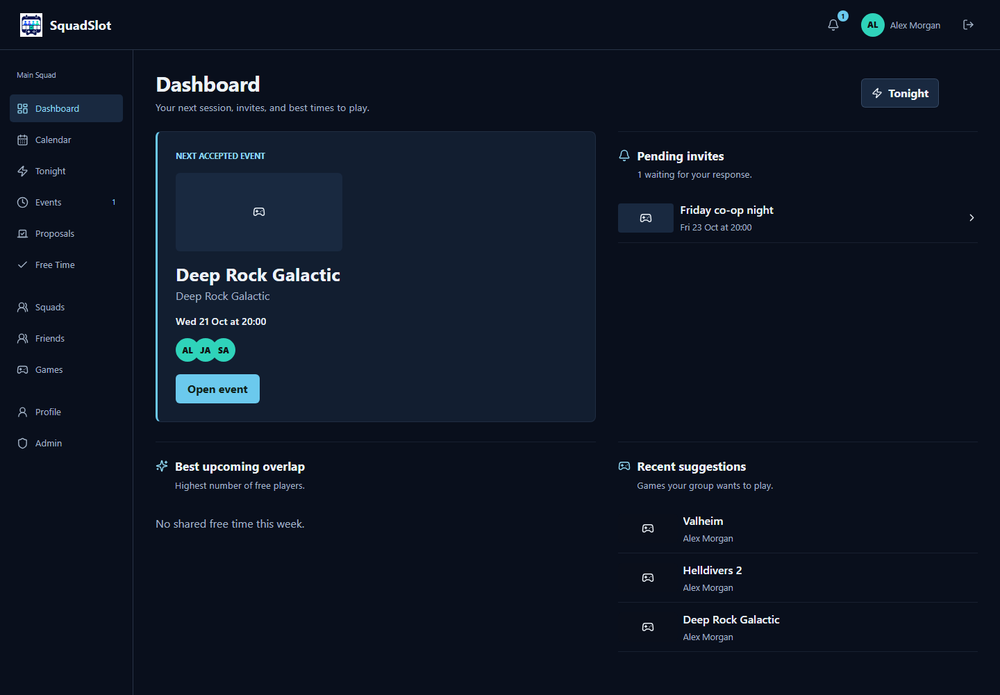
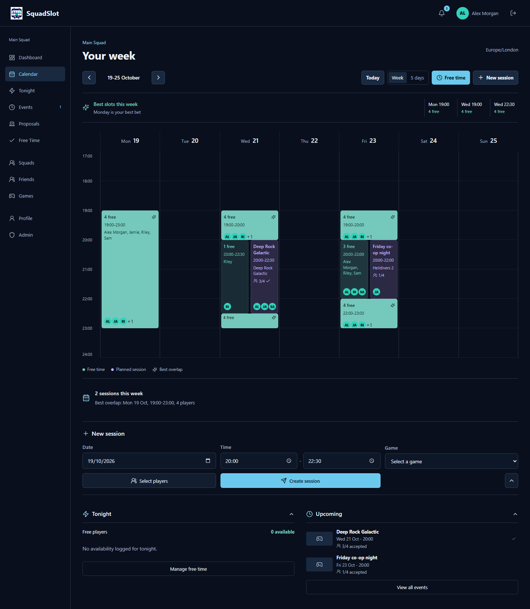

# SquadSlot

<p align="center">
  
</p>

SquadSlot is a self-hosted gaming calendar for friend groups. Share free time, find the best overlap, arrange sessions, vote on games, manage invitations, post Discord updates, and subscribe from a phone calendar.



## Highlights

- Midnight Board calendar with the Glacier palette, grouped availability, separate event lanes, Week/5-day modes, and responsive phone navigation
- One-off or recurring availability with multi-day drag selection
- Best-time finder that ranks the strongest player overlap
- Event invitations shown in Events until accepted, declined, removed, or completed
- Multiple squads with isolated members, calendars, events, and game suggestions
- Pre-event proposals with time and game voting plus random tie resolution
- Scheduling conflict warnings, capacity waitlists, and automatic promotion
- Event history for reviewing completed sessions
- Minimum and maximum player capacity with ready-state notifications
- Multiple game options, invitee voting, and random tie resolution
- Steam search-as-you-type with game artwork and details
- Event comments for servers, mods, DLC, and plan changes
- Private live calendar subscriptions for Apple Calendar, Google Calendar, and Outlook
- Discord updates, reminders, editable templates, test delivery, and bot RSVP buttons
- User profiles, colours, timezones, preferred hours, themes, and avatars
- Admin account management, audit history, temporary password resets, and encrypted scheduled backups
- Administrator-approved registration by default, with an option to close sign-ups
- Installable PWA for desktop and mobile home screens



## How It Works

1. The first registered account becomes the administrator.
2. Friends request accounts; an administrator approves them in Admin > Registration.
3. Everyone logs one-off or recurring free time.
4. SquadSlot highlights the strongest shared times.
5. A user creates an event, suggests games, and invites players.
6. Invitees respond, vote, comment, and optionally subscribe from their phone calendar.

No demo accounts or default passwords are created.

### Registration And Server Access

The first account becomes the administrator and can sign in immediately. Complete
this first-time setup before exposing a new installation publicly.

After that, new accounts require approval by default. Pending accounts cannot sign
in, access calendars, join squads, or use notifications. They are added to Main
Squad only after an administrator approves them under **Admin > Registration**.
Verify each request with your friend before approving it; names alone do not prove
identity. Rejected requests are deleted, so the person may request again.

Set **New accounts** to **Registration closed** to stop new requests entirely.
Existing accounts can still sign in, and outstanding requests can still be reviewed.
There is deliberately no unrestricted registration mode. These settings are saved
in the database, not `.env`, and included in backups.

On upgrade, existing accounts retain access. Review accounts that were created
before this protection was enabled. Pending status survives restarts and restores;
older backups without account status preserve their existing users as approved.

## Quick Start With Docker

Requirements:

- Docker Engine
- Docker Compose v2
- A writable Docker volume or host directory for SQLite

Clone the repository and create the deployment environment file:

```bash
git clone https://github.com/Nated4wgy/Squadslot.git
cd Squadslot
cp .env.example .env
nano .env
```

Set at least:

```env
SESSION_SECRET=replace-with-a-long-random-secret-at-least-32-characters
APP_URL=https://calendar.example.com
TZ=Europe/London
TRUST_PROXY=0
```

For Cloudflare Tunnel, also set `TRUSTED_TUNNEL_IPS` as described below. Do not
enable blanket proxy trust when the application is also reachable on your LAN.

Generate a suitable secret with:

```bash
openssl rand -hex 32
```

Build and start SquadSlot:

```bash
docker compose up -d --build
```

Open the configured HTTPS address:

```text
https://calendar.example.com
```

The included Compose file stores SQLite data in the `squadslot-data` named volume, mounted inside the container at `/data`.

For a same-machine development test, set `APP_URL=http://localhost:8080`, set `TRUST_PROXY=0`, and open `http://localhost:8080`. Use HTTPS for access from other devices.

## Hosting From Copied Files

Git is not required on the server. Copy the complete project folder to the server, excluding local-only folders such as `node_modules`, `dist`, and `data`, then run:

```bash
cp .env.example .env
nano .env
docker compose up -d --build
```

Keep `docker-compose.yml`, `Dockerfile`, `package.json`, `package-lock.json`, `server`, `src`, and `public` together in the same project directory.

## Domain And HTTPS

Point your domain at the server and reverse proxy it to port `8080`. The public URL in `APP_URL` must exactly match the HTTPS address users open.

Example Caddy configuration:

```caddy
calendar.example.com {
    reverse_proxy 127.0.0.1:8080
}
```

Recommended environment:

```env
APP_URL=https://calendar.example.com
TRUST_PROXY=1
```

HTTPS is strongly recommended because SquadSlot uses secure session cookies in production, provides PWA installation, and generates public subscription URLs from `APP_URL`.

### Cloudflare Tunnel With Local Access

For a separate `cloudflared` server forwarding directly to SquadSlot's LAN IP
and port, put these settings in the `.env` beside `docker-compose.yml`:

```env
APP_URL=https://calendar.example.com
TRUST_PROXY=0
TRUSTED_TUNNEL_IPS=192.168.1.196
```

Replace the example domain with your actual public domain. `192.168.1.196` is
the tunnel host in this deployment; other installations must use their own
connector address. Reserve that address in DHCP. Multiple connectors can be
listed as comma-separated exact IP addresses; subnets and hostnames are rejected.
Recreate the container after editing: `docker compose up -d --build`.

Only requests whose socket peer matches that list can supply trusted proxy
headers. Their `CF-Connecting-IP` becomes the visitor IP for request limits.
Missing or malformed visitor headers fall back to the connector IP, never an
arbitrary forwarded chain. Direct LAN requests use their socket IP and ignore
forwarded headers. This setting is specifically for Cloudflare Tunnel, not Caddy
or another generic proxy. Explicit tunnel addresses override legacy `TRUST_PROXY=1`.

On the origin server's firewall, allow the published application port from the
connector and intended LAN clients only. Do not forward this port on your router.
Check Docker's firewall rules as well as the host firewall: published Docker
ports may need filtering in Docker's forwarding chain. Keep the connector host
trusted; any process on it can impersonate its forwarded headers.

If Docker/network address translation changes the source IP seen by SquadSlot,
verify that source before configuring trust. Do not solve this by trusting the
whole LAN, a shared Docker gateway, or all proxies. Keep Cloudflare visitor-IP
headers enabled. UK-only filtering is an extra restriction, not authentication.
Account approval remains essential.

After deployment, check both the public HTTPS URL and LAN route. Production
session cookies require HTTPS, so plain LAN HTTP is not a full signed-in access
test; use the public HTTPS hostname locally or a trusted local HTTPS proxy.
Push and Discord delivery have been confirmed working by the operator; these
changes do not alter their notification settings.

Implementation references: [Express proxy trust](https://expressjs.com/en/guide/behind-proxies/)
and [Cloudflare visitor headers](https://developers.cloudflare.com/fundamentals/reference/http-headers/).

### Application Limits

One running instance applies these fixed-window limits, returning HTTP 429 with
`Retry-After` when exceeded:

- API requests: 600 per minute per visitor IP; health checks are excluded.
- Login, registration and password changes: 25 combined per IP per 15 minutes.
- Signed-in writes: 120 per account per minute.
- Admin backup operations, including listing/downloading/restoring: 30 per account per 15 minutes.

Limiter memory is bounded to 10,000 keys per limiter. When full, new keys are
temporarily refused rather than evicting existing protection. Limits reset when
the process restarts and are not shared across replicas. They are not a replacement
for edge-level traffic protection against distributed attacks.

Storage safeguards reject new rows at these limits without deleting accounts or
schedules:

| Records | Per Account | Whole Installation |
| --- | --- | --- |
| Users / pending users | - | 500 / 100 |
| Squads | - | 100 |
| Availability entries | 2,000 | 50,000 |
| Weekly availability rules | 100 | 10,000 |
| Availability presets | 50 | 10,000 |
| Recurrence exceptions | - | 50,000 |
| Events | 1,000 hosted | 20,000 |
| Event comments | - | 100,000 |
| Game suggestions | 200 | 10,000 |
| Event proposals | 200 hosted | 10,000 |

Event and availability notes have a 4,000-byte limit; proposals can invite at most
100 players. Existing records remain in place on upgrade. Quotas also apply to
restores: an oversized import fails transactionally without replacing the current
data. Remove unused records or review the limits before importing larger backups.
These are row/input safeguards, **not a disk-size quota**: audit/delivery logs,
SQLite WAL files and other tables still require disk monitoring and host-level
storage limits. Backup file count retention remains separately configurable.

## First Login

Open SquadSlot and create the first account before making the installation public. It automatically receives the `admin` role. Later registrations are pending requests until an administrator approves them under **Admin > Registration**. Approved accounts receive the normal user role unless an administrator promotes them.

If a user forgets their password, an administrator can open **Admin > Accounts**, choose **Reset password**, and set a temporary password. Existing sessions and the old password are invalidated immediately. After signing in with the temporary password, the user must choose a new password before accessing the rest of SquadSlot.

## Availability And Scheduling

Availability can be added in several ways:

- Drag over one calendar day to prefill a one-off time range.
- Drag across several days to preselect a recurring weekly schedule.
- Use quick presets such as Tonight, Tomorrow evening, Weeknights, Friday night, Saturday night, or Weekend evening.
- Create personal saved presets.
- Build recurring rules from the Availability page and skip individual dates as exceptions.

When several users are free, the calendar groups them into one entry. Hover, focus or tap an entry to show player names and session details beneath the calendar. Accepted or tentative events suppress overlapping free-time display for committed players; other free players remain visible beside the session.

The strongest shared slots are highlighted in teal; planned sessions use lilac. Use the week arrows or Today button to navigate, switch between Week and 5 days, and swipe horizontally through days on a phone. Free time and New session open the forms underneath the board. On desktop, an event's creator or an administrator can drag it to an empty time slot while preserving its duration. Drops that would push its end past midnight are rejected.

### Managing Your Free Time

Choose **My free time** above the calendar to see your original entries separately,
including availability that overlaps an accepted event. Daytime entries extend
the personal calendar's visible hours. Click or tap an entry to edit its date,
times or note, or delete it. Shared blocks in **Squad** mode open a list of the
players' entries; other people's entries are read-only unless you are an admin.

For repeating availability, choose **This date only** or the **whole series** for
that weekday. A single-date edit skips the original occurrence and creates an
independent entry. Future changes to the weekly rule leave that entry intact.
Deleting a series removes its remaining repetitions, not independent exceptions.
Multi-day schedules store each weekday as a separate rule.

The **Free Time** page provides a dated weekly agenda, with week navigation and
the same editor. Recurring rules show their start/end dates and next occurrence.
Administrators also default to their own entries; use **Manage player** in the
personal calendar or **Show > All squad members** in the agenda to manage others.

## Live Calendar Subscriptions

Each account can generate a private feed from **Profile > Live calendar subscription**. The stable `.ics` URL includes:

- Accepted and tentative events
- The account owner's free-time entries
- Other users' names only for the exact periods when they overlap the account owner's free time

Accepted or tentative event time is removed from availability before the feed is generated. Other users' unrelated availability is never included.

- Apple Calendar: use **Subscribe** or add the `webcal://` URL.
- Google Calendar: choose **Other calendars > From URL** and paste the HTTPS URL.
- Outlook: choose **Add calendar > Subscribe from web** and paste the HTTPS URL.

SquadSlot requests a 15-minute refresh, but each provider controls its actual polling schedule. Google Calendar may take substantially longer to show changes.

The subscription URL is a bearer credential. Anyone with the URL can read that user's events, free time, and matching availability. Regenerate or revoke the link immediately if it is exposed.

## Discord Integration

SquadSlot supports simple one-way webhooks and an optional Discord application for RSVP buttons. A gateway process is not required.

Create a webhook from the target Discord channel under **Edit Channel > Integrations**, then configure it from the Admin page or `.env`:

```env
DISCORD_WEBHOOK_URL=https://discord.com/api/webhooks/your-webhook-url
DISCORD_BOT_NAME=SquadSlot
```

Available notifications include:

- Availability added or removed
- Game suggested
- Session invite created or removed
- Invite response changed
- Minimum player count reached
- Event tomorrow
- Event starting in one hour
- RSVP deadline
- Weekly availability summary

Administrators can enable or disable each notification, edit title and message templates, set reminder timing, and send a test webhook.

For Accept, Tentative, and Decline buttons, create a Discord application and bot, add it to the server with permission to view the target channel and send messages, then enter the application ID, public key, bot token, and channel ID under **Admin > Discord**. Set the application's Interactions Endpoint URL to the URL shown there, for example:

```text
https://calendar.example.com/discord/interactions
```

Each player must also enter their numeric Discord user ID in **Profile**. Incoming interactions are verified with Discord's Ed25519 signature before an RSVP is changed.

## Administration And Backups

Administrators can:

- Promote or demote accounts
- Approve or reject account requests, or close registration completely
- Set temporary passwords for locked-out users
- Configure and test Discord
- Manage notification templates and reminder settings
- Download an encrypted full backup and restore encrypted or legacy JSON backups
- Run encrypted on-disk backups and review administrative audit records

Backups include:

- Users and bcrypt password hashes
- Availability, recurring rules, exceptions, and presets
- Events, invitations, capacity, votes, and comments
- Profiles and appearance settings
- Live calendar subscription token hashes
- Discord settings, notification rules, and reminder history

Backups also include squads, proposals, UTC event timestamps, Discord identities, and audit records. They do not contain plaintext account passwords, but they can contain a Discord webhook URL and authentication hashes, so store them privately.

To enable encrypted automatic backups in `/data/backups`, set:

```env
AUTO_BACKUP_ENABLED=true
BACKUP_ENCRYPTION_KEY=replace-with-a-long-separate-backup-secret
BACKUP_INTERVAL_HOURS=24
BACKUP_RETENTION=14
```

All new downloads and on-disk backups are encrypted; there is no unencrypted export fallback.
Set `BACKUP_ENCRYPTION_KEY` even when automatic backups are off, then recreate the
container with `docker compose up -d`. Use a separate, randomly generated secret,
preferably 32 random bytes encoded as hex. For example, generate one on your server
with `openssl rand -hex 32` and put the result in `.env`. Do not reuse SESSION_SECRET.

Keep the key in a password manager or another secure location outside the backup
volume. Protect `.env` too. The original key is required for recovery: losing it
makes encrypted backups unrecoverable. Changing it does not re-encrypt older files;
retain each old key until its backups are no longer needed. Backups never include
the environment encryption key. Keep a separate off-server copy of backup files.

In **Admin > Backup and restore**, download an encrypted file or save one on the
server. To restore, select a `.json.enc` file (or an older `.json` backup), review
the warning, tick the confirmation and choose **Restore and sign out**. Selecting
a file alone changes nothing. Restore replaces all squads and accounts and signs
everyone out; log in using credentials from the restored backup. Save a current
backup before restoring. Push subscriptions are not restored; users must enable
push again on their devices.

Calendar subscription links are revoked by default during restore. Members must
generate new links and resubscribe. You can explicitly preserve links from the
backup for a routine recovery, but never do this if a backup or link was exposed.
Old unencrypted JSON and version-1 encrypted files remain importable. Uploads are
limited to 32 MB and accepted only after administrator authentication. New files
use AES-256-GCM with a per-file salt, IV and full-length authentication tag. On
Linux, newly created backup directories/files use owner-only permissions. Existing
directory permissions are not changed; review these on an upgraded installation.

Test recovery on an isolated installation with outbound notifications disabled
before relying on backups. Encryption protects stored files, not a compromised
running server or an administrator account.

## Updating

### Scheduling Timezones And Conflicts

All shared scheduling inputs and displays use the active squad's timezone, shown
above the page. This includes events, proposals, availability, Tonight and presets.
Your profile timezone is the default when creating a new squad; it does not shift
the shared schedule. Calendar exports use UTC, so Google, Apple and Outlook can
display them in the device's chosen timezone. Existing availability wall-clock
values are preserved and interpreted in the squad timezone, as on the shared board.

Weekly availability stays at the same local time through daylight-saving changes.
An occurrence whose start or end falls in a missing spring-forward hour or a
repeated autumn hour is skipped. One-off entries reject those times instead of
silently shifting them. Choose a time outside that hour. Overnight creation still
requires separate daily entries. Weekly Discord summary times are local to each
squad, not the server operating system.

Accepting an invitation checks accepted/tentative commitments across all squads.
Creating or finalising an event checks the host; rescheduling checks the host and
accepted/tentative attendees. Conflicts return a warning without applying the
change. An explicit `force: true` API override remains available; automatic
waitlist promotions never override conflicts. Rescheduling warnings do not reveal
other attendees' private event titles.

Waitlist priority is based on when someone joined the queue. Repeated responses
keep their position; leaving and rejoining starts a new position. Promotions skip
players with conflicting commitments and keep them waiting. Existing queues keep
their old order when upgrading, since their original join times are unavailable.
Join timestamps are included in backups; legacy backups use a stable user-ID order.

### Apply An Update

Create an Admin backup before upgrading, then update and rebuild:

```bash
git pull
docker compose up -d --build
```

For a manually copied deployment, replace the application files while preserving `.env` and the Docker volume, then run:

```bash
docker compose up -d --build
```

Database migrations are additive and run automatically when the new container starts. The `squadslot-data` volume persists across rebuilds.

See [CHANGELOG.md](CHANGELOG.md) for release details.

## Troubleshooting

Check container status and recent logs:

```bash
docker compose ps
docker compose logs --tail=150 squadslot
```

Common causes of restart loops:

- `SESSION_SECRET` is missing or shorter than 32 characters.
- A bind-mounted `/data` directory is not writable by the container user.
- Another service already uses port `8080`.
- `APP_URL` does not match the public domain or proxy scheme.

If old UI assets remain after an update, perform a hard refresh or remove and reinstall the PWA so the updated service worker takes control.

## Device Push Notifications

1. Host SquadSlot on HTTPS and set its public **App URL** in Admin (or `APP_URL` in Docker).
2. Open **Profile > Device notifications** on each device and choose **Enable on this device**. Allow the browser permission request.
3. Choose whether that device receives event invites, event reminders, or both. Use **Send test** to check delivery.

On iPhone and iPad, install SquadSlot using **Share > Add to Home Screen**, then enable notifications from the installed app. Browser/OS notification settings and Focus modes can delay or suppress delivery.

Pending invites are checked once a minute. Accepted and tentative sessions can receive reminders within 24 hours and within one hour of starting, using the administrator's existing tomorrow/starting-soon reminder switches. These run independently of Discord. Each notification opens the Events page. Signing out disables notifications on that device; password resets invalidate existing device registrations.

VAPID signing keys are generated automatically and stored in the database. Preserve the Docker data volume during updates. Optional `PUSH_SUBJECT` can specify an HTTPS contact URL or `mailto:` address; otherwise the public App URL is used. Browser subscriptions are device-specific and are not included in JSON exports; enable notifications again after a JSON restore. No email service or Discord bot is required.

## Local Development

Requirements:

- Node.js 22 LTS (also used by the Docker image)
- npm

Install and run:

```bash
npm ci
npm run dev
```

Frontend:

```text
http://localhost:5173
```

API:

```text
http://localhost:8080
```

Verification:

```bash
npm run lint
npm test
npm run build
```

`npm test` includes security regression checks for permissions, malformed requests,
calendar ranges, Discord callbacks, and backup session invalidation. Browser layout
checks are available through `node scripts/layout-review.mjs` and the same command
with `--webkit` after installing the corresponding Playwright browsers.

### Security Update Notes (October 2026)

- Rebuild the Docker image when updating to pick up the Node 22 runtime and dependency fixes. Preserve the data volume.
- Restoring a JSON or encrypted backup signs everyone out. Sign back in with the credentials in the restored backup; old browser sessions are not restored.
- New and reset passwords require at least eight characters and at most 72 UTF-8 bytes (the bcrypt limit). Existing passwords still work.
- Admin's saved App URL takes precedence over `APP_URL` for subscription links and push configuration. Use the same public HTTPS URL in both places.
- `TRUST_PROXY=1` is legacy one-hop proxy trust and emits a warning. Use exact `TRUSTED_TUNNEL_IPS` for Cloudflare Tunnel plus LAN access; do not expose one-hop trust directly to untrusted clients.
- Availability query ranges are limited to 366 days. Normal weekly views and live calendar subscriptions remain supported.

See [the October audit](docs/audits/2026-10-12.md) for scope, fixes, and remaining limitations.

Run the production server without Docker:

```bash
SESSION_SECRET=replace-with-a-long-random-secret-at-least-32-characters npm start
```

## Environment Variables

| Variable | Default | Purpose |
| --- | --- | --- |
| `PORT` | `8080` | Express server port |
| `DATABASE_PATH` | `/data/squadslot.db` in Docker | SQLite database location |
| `TZ` | `Europe/London` | Container timezone |
| `SESSION_SECRET` | none in production | Signs login sessions; minimum 32 characters |
| `APP_URL` | `http://localhost:8080` | Public base URL used for links and calendar feeds |
| `PUSH_SUBJECT` | App URL | Optional HTTPS or mailto contact for Web Push signing |
| `TRUST_PROXY` | `0` | Set to `1` behind a trusted reverse proxy |
| `TRUSTED_TUNNEL_IPS` | empty | Exact comma-separated cloudflared peer IPs; overrides legacy proxy trust |
| `DISCORD_WEBHOOK_URL` | empty | Optional Discord webhook |
| `DISCORD_BOT_NAME` | `SquadSlot` | Discord webhook display name |
| `DISCORD_APPLICATION_ID` | empty | Discord application ID for interactive RSVP buttons |
| `DISCORD_PUBLIC_KEY` | empty | Discord application Ed25519 public key |
| `DISCORD_BOT_TOKEN` | empty | Bot token used to post interactive messages |
| `DISCORD_CHANNEL_ID` | empty | Channel receiving interactive bot messages |
| `AUTO_BACKUP_ENABLED` | `false` | Run encrypted backups on a schedule |
| `BACKUP_ENCRYPTION_KEY` | empty | Secret used for AES-256-GCM backup encryption; minimum 16 characters |
| `BACKUP_INTERVAL_HOURS` | `24` | Hours between automatic backups |
| `BACKUP_RETENTION` | `14` | Number of encrypted backups retained |
| `SQUADSLOT_CLEAN_DEMO_DATA` | `false` | Development-only cleanup for legacy seeded demo users |

## Security

- Passwords are stored as bcrypt hashes.
- Login sessions use signed HTTP-only, same-site cookies.
- Production requires a strong `SESSION_SECRET`.
- State-changing API requests enforce JSON content type and same-origin checks.
- Authentication endpoints have in-memory rate limiting.
- Discord webhook URLs are restricted to Discord webhook hosts.
- Discord interactions require a valid Ed25519 request signature.
- Squad-scoped records are checked against the active membership on every API operation.
- Subscription tokens are random bearer credentials stored as SHA-256 hashes.
- Common CSP, frame, referrer, permissions, and content-sniffing headers are enabled.
- The Docker runtime runs as the unprivileged `node` user.

## Technology

- React and Vite
- Node.js and Express
- SQLite through `better-sqlite3`
- Docker multi-stage build
- Steam Store public endpoints
- Discord webhooks
- iCalendar (`.ics`) feeds
- Progressive Web App manifest and service worker

## Steam Availability

Steam search uses public Steam Store endpoints from the server. If Steam is temporarily unavailable or rate-limited, SquadSlot remains usable and game search results may be empty until Steam responds again.

Event summaries use Steam artwork, including the dashboard's next session, invites, event lists, calendar details, and upcoming sessions. Images fall back to the game's Steam ID when an older event has no saved image URL. Artwork remains externally hosted; unavailable images show a neutral game icon. An undecided multi-game vote does not display an arbitrary game's artwork.
