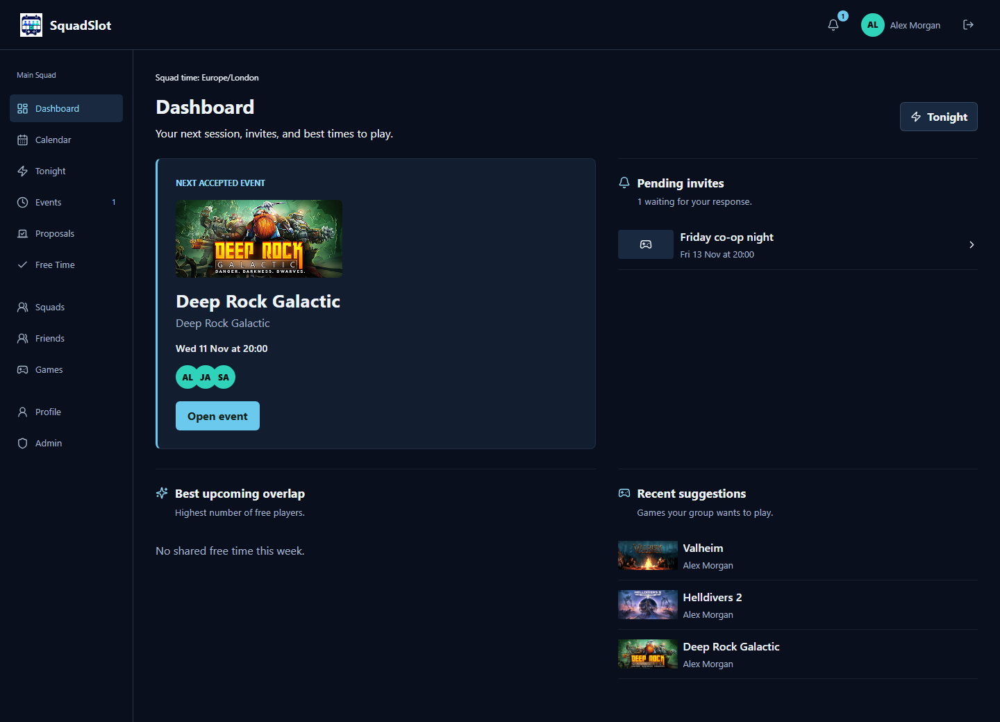
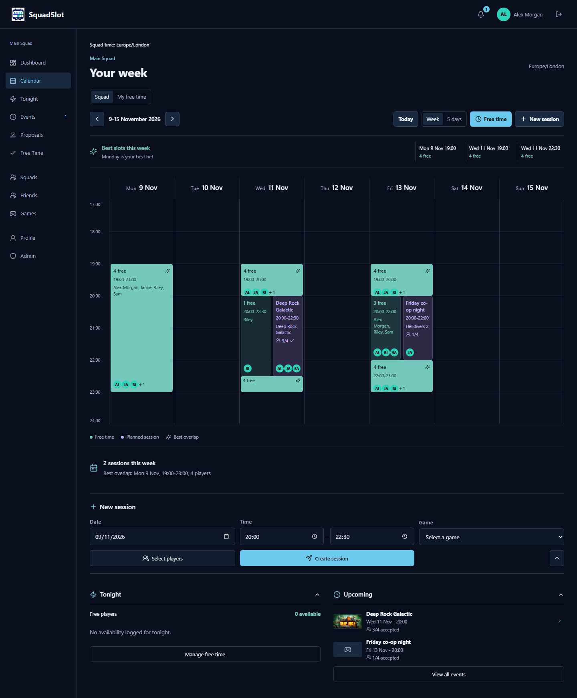
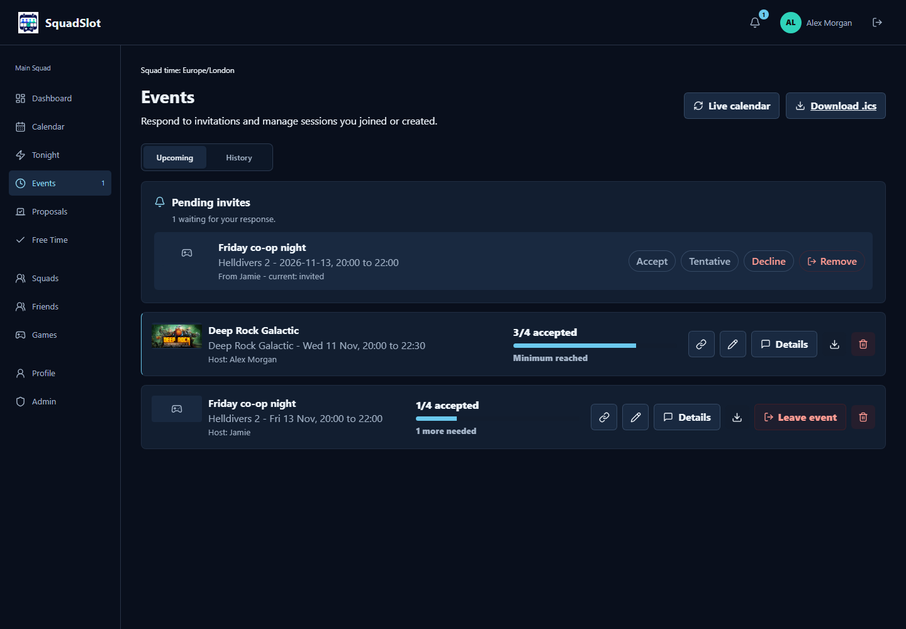
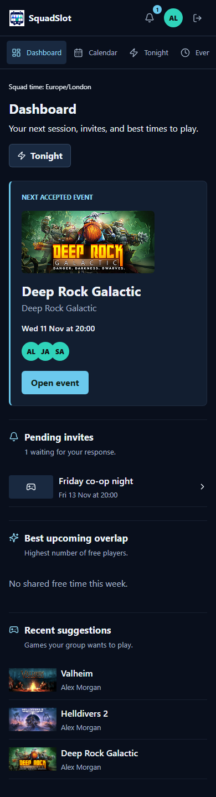

# SquadSlot 1.0.0

## Your squad. One calendar. More game nights.

SquadSlot is a self-hosted gaming planner for friends. Put your free time on a
shared calendar, find a slot that works for the group, pick a game and get a
session booked. Run it on your own Linux server with Docker and use it from a
desktop, tablet or phone.

This is the **first tagged release**, bringing the project so far together in
one installable version.



## Find Time Together

- Shared calendar with individual players, overlapping free time and planned sessions.
- Weekly recurring availability, individual-date exceptions and overnight sessions.
- Best-time suggestions, plus a Friends planner for a specific group and minimum duration.
- Personal free-time management and drag selection on the calendar.



## Turn A Slot Into A Session

- Private templates for your regular game nights.
- Invitations with accept, tentative and decline responses.
- Minimum/maximum capacity, waitlists and automatic promotion when space opens.
- Steam game search and artwork, game voting and random tie-breaking.
- Session comments for server details, mods, DLC and voice chat.
- Host/admin editing, event history and shareable links that still require squad access.



## Keep Everyone In The Loop

- Configurable browser push notifications and Discord webhook updates/reminders.
- Downloadable .ics events and private calendar subscriptions for phone calendars.
- Visible pages refresh every 15 seconds without clearing your open drafts.
- Installable PWA, dark/light themes and selectable accents.
- Glacier Midnight Board styling with animated navigation, progress bars and event-change highlights. Reduced-motion preferences are respected.



## Your Server, Your Squad

New accounts need administrator approval, and registration can be closed entirely.
Multiple squads keep their calendars separate. Admin tools include temporary
password resets, audit history, encrypted backups, disk-space monitoring and
log retention. Exact-IP Cloudflare Tunnel trust supports a separate connector
host while retaining local network access.

## Install

Download and extract **Source code (zip)** below, or clone the repository:

```bash
git clone --branch v1.0.0 https://github.com/Nated4wgy/Squadslot.git
cd Squadslot
cp .env.example .env
```

Set a unique `SESSION_SECRET` of at least 32 characters and your public HTTPS
`APP_URL` in `.env`. Configure encrypted backups and proxy settings for your
deployment using the [installation guide](https://github.com/Nated4wgy/Squadslot/blob/v1.0.0/README.md).

```bash
docker compose up -d --build
```

**Create the first administrator account before exposing a fresh installation
publicly.** Afterwards, approve your friends' account requests in Admin.

This release provides source code that Docker builds locally; it does not publish
a prebuilt container image. The Compose named volume persists your database.

## Updating An Existing Installation

1. Export an encrypted backup and keep the encryption key somewhere safe.
2. Stop the app and take a consistent copy/snapshot of its data volume as an additional rollback option.
3. Update the source to `v1.0.0`, retaining your `.env` and existing data volume.
4. Run `docker compose up -d --build` and check `docker compose logs --tail=100`.
5. Check login, an existing event, and one push/Discord test after deployment.

Do not run `docker compose down -v`: that deletes the named data volume.
Schema updates run on startup. To roll back, restore both the previous source and
the matching pre-upgrade data, rather than running old code against newer data.

## Verification And Notes

The release was checked with production-build and lint checks, isolated API/security
regression tests, and Chromium/WebKit desktop/mobile workflows. Docker itself was
not available in the development environment, so verify the container build on
your server. Push and Discord transports are covered by isolated tests; real
delivery also depends on your server configuration.

Calendar subscription refresh frequency is controlled by the receiving calendar
app. Game artwork/search depends on Steam availability. Screenshots show fictional
accounts and example sessions; no demo accounts are installed.

See the [changelog](https://github.com/Nated4wgy/Squadslot/blob/v1.0.0/CHANGELOG.md)
for the detailed development history.
